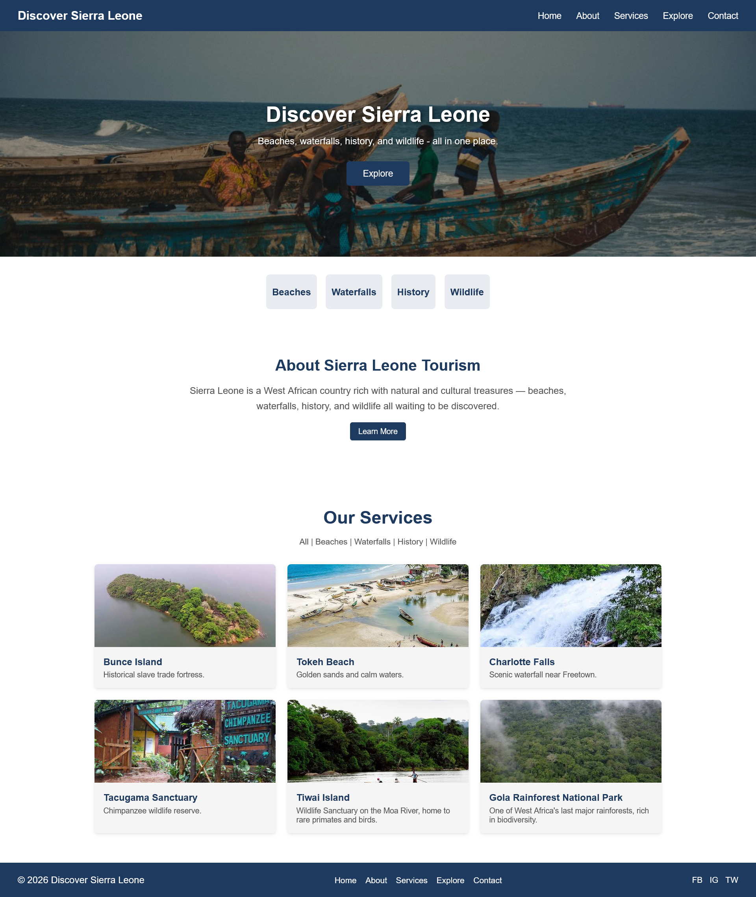
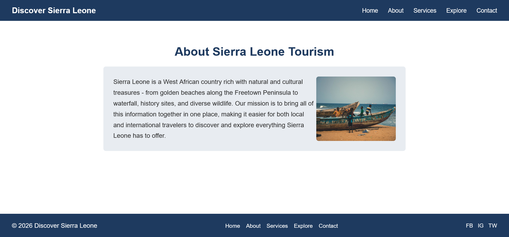
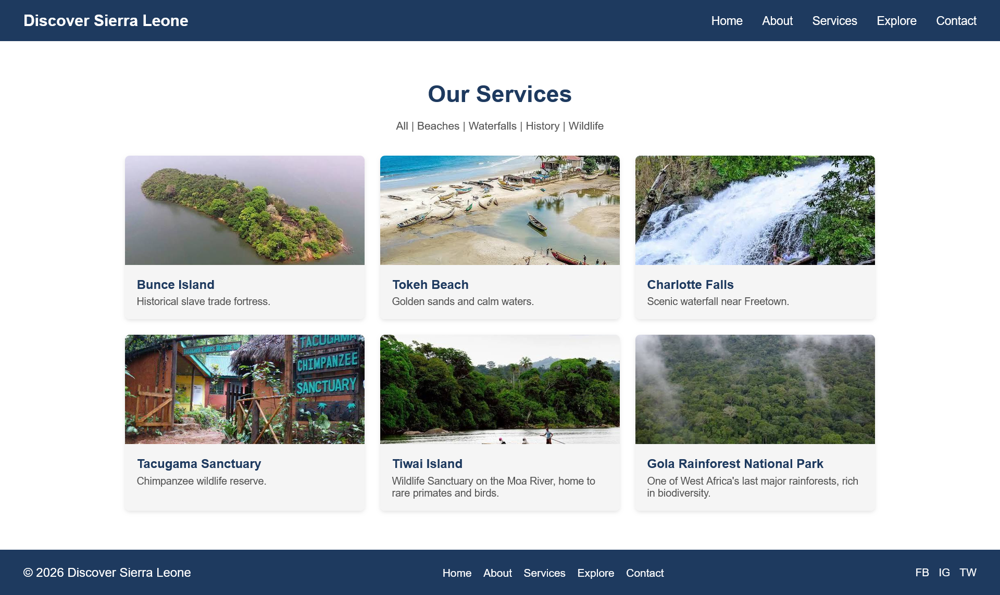
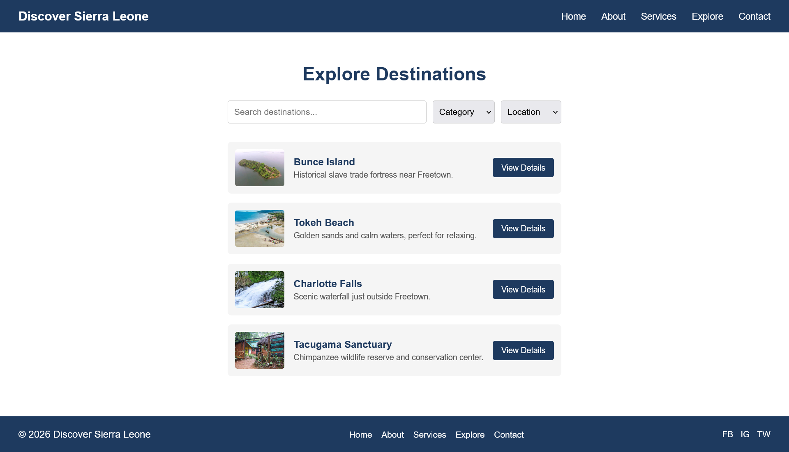
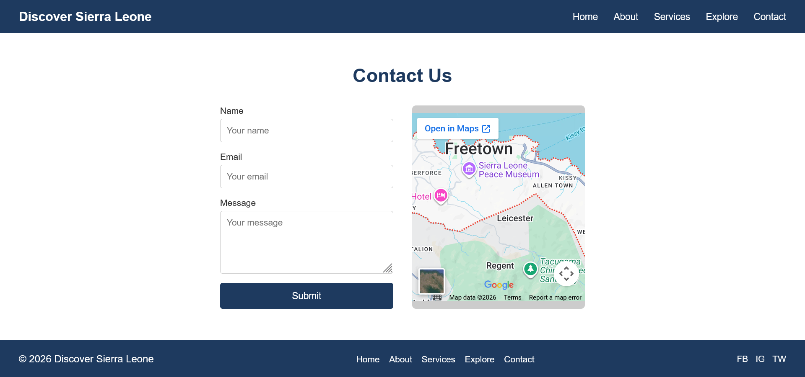

# Discover Sierra Leone

A responsive tourism website promoting Sierra Leone’s beaches, waterfalls, historical sites, and wildlife.

**Course:** DIT1203 – Web Design (Assignment 2)
**University:** Limkokwing University of Creative Technology, Sierra Leone
**Author:** Alhaji . W. Timbo

## Background

Sierra Leone is a West African country richly endowed with natural and cultural tourism assets, including pristine beaches along the Freetown Peninsula, waterfalls such as the Bathurst and Charlotte Falls, historic sites like Bunce Island and the Sierra Leone National Museum, and diverse wildlife found in reserves such as Tacugama Chimpanzee Sanctuary, Gola Rainforest National Park, and Tiwai Island. Despite this potential, the tourism sector in Sierra Leone remains largely underdeveloped. Many of these attractions are not well documented online, limiting both local and international visitors’ ability to discover, plan, and enjoy trips within the country.

## Problem

There is no single, well-organized, and easily accessible online platform dedicated to promoting tourism in Sierra Leone. Information about attractions, accommodation, transportation, and travel tips is scattered across social media pages, informal blogs, or shared only through word of mouth, making it difficult for both first-time and returning visitors to plan trips efficiently.

## Proposed Solution

This project is a responsive tourism website, **”Discover Sierra Leone,”** that serves as a centralized hub of information about the country’s top attractions, categorized by type (beaches, waterfalls, historical sites, wildlife reserves, and cultural experiences).

## Target Users

- **International Tourists** – travelers planning a visit to Sierra Leone who need reliable, centralized information.
- **Local/Domestic Tourists** – Sierra Leoneans exploring attractions within their own country.
- **Tour Operators & Travel Agencies** – businesses promoting their services to a wider audience.

## Pages

- **Home** – Hero banner, category links (Beaches, Waterfalls, History, Wildlife), About preview
- **About** – Background on Sierra Leone tourism and the website’s mission
- **Services** – Grid of attractions (Beaches, Waterfalls, History, Wildlife, Gola Rainforest, Tiwai Island, and more)
- **Explore** – Searchable/filterable list of destinations
- **Contact** – Contact form and embedded map

## Features

- Fully responsive design (mobile, tablet, desktop)
- Consistent navigation bar and footer across all pages
- Clickable logo linking back to the homepage
- Google Maps embed on the Contact page

## Tech Used

- HTML5
- CSS3 (Flexbox, Grid, Media Queries)

## Screenshots

### Home

### About

### Services

### Explore

### Contact

